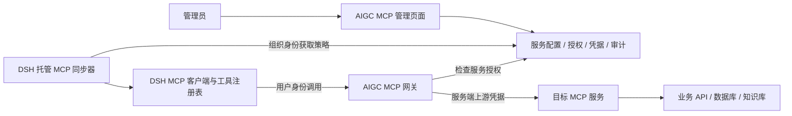

# AIGC 与 DSH 独立 MCP 市场接入方案

日期：2026-10-22
状态：设计文档，尚未实现、部署或完成端到端验证。
依据：当前工作区源码（包含未提交改动），不代表线上或已发布安装包状态。

## 1. 目标与基本概念

管理员在 AIGC 中台单独登记 MCP 服务、配置鉴权并授予用户使用权限；用户登录弯崽工作助手（DSH）后自动获取获授权的服务，模型可以发现并调用其工具。

MCP 是客户端和工具服务之间的通信规范。远程 MCP 通常提供一个 HTTP/HTTPS 地址，但普通 HTTP API 不会因为登记到中台就成为 MCP 服务。目标服务必须实现 MCP；现有业务只有 REST API 或数据库时，需要先开发 MCP 适配服务。

例如：用户要求查询产品 SN001 → 模型选择追溯查询工具 → DSH 通过 MCP 调用 → MCP 服务查询业务系统 → 结果返回模型生成回答。

MCP 市场和插件市场独立管理：

| 项目 | 插件市场 | MCP 市场 |
|---|---|---|
| 管理对象 | 插件代码包及版本 | MCP 服务及连接策略 |
| 发布内容 | tgz、bundle patch、配置 | 地址、鉴权、授权、超时、策略修订号 |
| 客户端行为 | 下载、校验、安装、加载 | 同步策略、建立连接、发现和调用工具 |
| 更新 | 可能需要重启 Host | 原则上重建连接，无需重新安装客户端 |
| 数据 | ManagedPlugins 等现有表 | 独立 MCP 表，复用授权基础设施 |

本方案不通过为每个 MCP 制作一个 tgz 来实现市场管理。DSH 的 MCP 通用运行能力随客户端交付。

## 2. 当前源码能力与缺口

### 2.1 已存在的能力

| 源码位置（仓库根目录相对路径） | 可复用内容 |
|---|---|
| `deepseek-harness/packages/mcp/mcp-client/src/index.ts` | MCP 配置校验、服务命名空间、连接与工具发现的启动协调 |
| `deepseek-harness/packages/mcp/mcp-client/src/transport.ts` | stdio 与 Streamable HTTP transport；HTTP 支持配置 headers |
| `deepseek-harness/packages/mcp/mcp-client/src/connection.ts` | 连接监督、重连和释放 |
| `deepseek-harness/packages/mcp/mcp-client/src/tools.ts` | 工具发现、注册、执行及结果适配 |
| `deepseek-harness/packages/mcp/mcp-resources/` | 共享 MCP 资源发现与读取能力 |
| `deepseek-harness/packages/boot/plugin-manager/src/managed-sync.ts` | 组织登录后策略同步、账号切换检查、失败关闭等实现参考 |
| `server/AigcHub.Api/Services/AccessGrantService.cs` | 用户、角色、部门授权，任一命中即可 |
| `server/AigcHub.Api/Endpoints/DshManagedEndpoints.cs` | 组织用户会话解析 `UserAsync` |
| `server/AigcHub.Api/Endpoints/PluginMarketEndpoints.cs` | 管理权限、策略、状态回报及审计的实现参考 |
| `portal/app/admin/plugins/` | 管理列表、配置弹窗、授权选择器和状态分页参考 |

DSH 原生客户端当前默认工具调用超时为 60 秒，支持连接断开后自动重连；默认不启用任何 MCP 服务。具体默认值以实施时源码为准。MCP prompts 模板当前不支持；第一阶段只承诺工具接入，不把整个 MCP 标准的所有可选能力视为已支持。

### 2.2 需要新增或改造

- AIGC：MCP 服务管理、凭据管理、发布、授权、连接测试、状态查询和调用审计。
- AIGC：具有 MCP 协议语义的网关，负责下游用户鉴权、上游连接和工具转发。
- DSH：独立托管 MCP 同步器、动态连接实例生命周期、连接状态事件和界面。
- DSH：HTTP 凭据动态获取与刷新。当前 transport 使用配置中的静态 headers，不能假定现有实例会自动替换过期 Token。
- DSH：服务级连接健康状态接口。现有 MCP 客户端具备内部连接监督，但不能直接当作已提供给中台的状态报告 API。
- 双端：客户端能力协商，避免旧 DSH 收到策略却无法执行。

## 3. 第一阶段范围

支持远程 `streamable-http`、服务级授权和工具调用。默认采用 AIGC 网关模式，使用现有组织登录体系。

第一阶段暂不支持：本地 stdio 程序分发、公共商店审核、OAuth 第三方交互授权、工具级授权配置、MCP prompts，以及面向用户自由填写任意命令的入口。需要这些能力时单独设计，不能静默透传为已支持。

服务可暴露多个工具。管理员登记服务后通过连接测试发现工具，无需逐个手工填写工具参数。

## 4. 目标架构



控制面负责“谁可以连接哪个服务”；调用面负责“每次调用是否仍被允许”。LiteLLM 不承担 MCP 路由，现有模型调用链保持独立。

### 4.1 默认网关模式

- DSH 获得中台网关地址，上游地址和服务凭据保留在服务端。
- 网关每次接收请求时检查账号有效性、服务启用状态和授权；已有连接不能绕过撤权。
- 凭据轮换后由网关更新上游连接，不要求把长期共享密钥下发客户端。
- 授权撤销后拒绝新请求，关闭或失效关联连接；已经执行的操作不保证能够撤回。
- 网关不拥有目标系统之外的额外业务权限；共享服务账号与用户数据权限的映射必须由目标服务明确实现。

### 4.2 可选直连模式（后续扩展）

若目标服务只能从用户电脑网络访问，可设计 DSH 直连。此时客户端需要持有目标服务凭据，目标服务必须自行鉴权；中台撤权后的生效不能只依赖客户端轮询。第一阶段不提供长期共享密钥下发功能。

中台连接测试和客户端连接测试分别反映各自的网络可达性。两者不可互相替代。

## 5. 中台管理流程

1. 管理员新增服务，填写展示名称、稳定标识、上游地址、超时和鉴权方式；默认停用。
2. 服务端测试 MCP 连接并发现工具，保存测试时间、协议版本和工具快照。
3. 展示工具名称、描述与参数结构，供管理员核对，不在测试时自动执行业务工具。
4. 选择用户、角色、部门使用范围；三类授权取并集，空授权表示无人可用。
5. 保存并发布，使服务启用。DSH 下次同步创建连接。
6. 在状态页面查看设备连接结果；通过专用测试工具或选定只读业务用例验证真实调用。
7. 修改地址、授权或启停后发布新策略；客户端按修订号重建连接或移除工具。

建议菜单：`MCP 服务`、`MCP 客户端状态`；操作权限使用独立的 `mcp.manage`。客户端使用权限不因拥有管理权限自动获得。

## 6. 数据模型（拟新增）

以下是设计字段，当前数据库尚不存在这些实体。

### 6.1 ManagedMcpServices

| 字段 | 含义 |
|---|---|
| Id | 服务 UUID，生命周期内稳定 |
| Code | 唯一稳定标识，对应工具 namespace；格式限制为 `[A-Za-z0-9_-]{1,32}` |
| Name / Description | 展示信息，不参与工具身份计算 |
| Transport | 第一阶段固定 `streamable-http` |
| ConnectionMode | 第一阶段固定 `gateway` |
| UpstreamUrl | 上游地址，只允许管理端读取 |
| AuthType | 第一阶段 `None` / `Bearer` / `Header` |
| CredentialProtected / HeaderName | 加密凭据及指定鉴权头名称 |
| IsEnabled | 全局启停，默认 false |
| Revision | 策略修订号，初始 1 |
| ToolCallTimeoutMs | 业务调用超时，有服务端最大值 |
| LastTestAt / LastTestStatus | 最近一次中台连接测试结果 |
| CreatedAt / UpdatedAt | 管理时间 |

服务 Code 发布后不允许修改，避免工具名变化影响历史会话和权限规则；展示名称允许修改。

### 6.2 其他数据

- `AccessGrants`：复用，资源键为 `mcp:{服务Id}`，不与 `plugin:{Id}` 混用。
- `ManagedMcpToolSnapshots`：服务 ID、原始工具名、描述、输入 schema、快照时间及哈希。快照用于预览，不替代运行时发现。
- `ManagedMcpReports`：用户 ID、设备 ID、服务 ID 为联合唯一键，保存期望修订号、实际修订号、状态、工具数量、错误码和更新时间。
- `OperationAudits`：复用管理审计，新增 `mcp.create`、`mcp.publish`、`mcp.test`、`mcp.credential.rotate` 等操作。
- MCP 调用审计：用户、设备、服务、工具名、耗时、结果类别、关联请求 ID；默认不记录参数正文、结果正文和凭据。

Revision 在连接策略、凭据、授权或启停发生实际变化并成功发布时加 1；无变化保存不增加。授权和策略必须在同一事务中提交。客户端报告中的实际修订号只在对应连接及工具发现成功后更新，不能直接复制期望值冒充生效。

这与现有插件“每次保存都加 1”的行为不同，页面说明需分别明确。

## 7. 接口契约（拟新增）

### 7.1 管理端

统一要求 `mcp.manage`，列表与状态接口使用现有分页结构。

| 方法 | 路径 | 用途 |
|---|---|---|
| GET | `/api/mcp/services` | 服务列表，凭据只返回是否已配置 |
| POST | `/api/mcp/services` | 新增停用服务 |
| PUT | `/api/mcp/services/{id}/policy` | 原子保存配置、授权及启停，带预期 Revision 防止覆盖 |
| GET | `/api/mcp/grant-options` | 授权候选用户、角色、部门 |
| POST | `/api/mcp/services/{id}/test` | 连接与发现测试，不自动执行业务工具 |
| GET | `/api/mcp/services/{id}/tools` | 最近一次工具快照 |
| GET | `/api/mcp/reports` | 客户端最后状态分页 |

凭据更新要区分“不修改”“替换”“清空”，不能用空字符串同时表达三种含义。管理端返回值和日志不得回显明文。

### 7.2 DSH 控制面

| 方法 | 路径 | 用途 |
|---|---|---|
| GET | `/v1/mcp/policy` | 获取当前用户完整服务策略快照 |
| POST | `/v1/mcp/reports` | 上报设备实际连接状态 |

策略响应示意（新接口设计，不是当前可调用接口）：

```json
{
  "schemaVersion": 1,
  "userId": "11111111-1111-4111-8111-111111111111",
  "services": [
    {
      "id": "22222222-2222-4222-8222-222222222222",
      "name": "生产追溯查询",
      "serverName": "enterprise_trace",
      "revision": 3,
      "enabled": true,
      "transport": "streamable-http",
      "connectionMode": "gateway",
      "endpointPath": "/v1/mcp/gateway/22222222-2222-4222-8222-222222222222",
      "toolCallTimeoutMs": 60000
    }
  ]
}
```

完整快照仅包含用户当前获授权且启用的服务；客户端必须移除快照中消失的托管服务。返回 401/403、无效策略或同步超过允许的新鲜度时，关闭托管连接；正常响应中的空数组也必须清空托管连接。不得因此移除个人本地 MCP。

客户端由可信中台 endpoint 与相对路径组合地址；不接受策略将组织令牌发送到任意域名。策略不包含组织会话令牌、上游长期凭据或上游 URL。

### 7.3 MCP 调用面

`/v1/mcp/gateway/{serviceId}` 是拟新增的 MCP endpoint，具体 HTTP 方法、headers、通知和流式行为遵循实际协商的协议版本，而非自行定义 REST 工具协议。

DSH 通过现有组织凭据服务按请求获取有效令牌。若需专用短期 MCP 凭据，应新增服务受限的签发与验证机制；不能把长期组织令牌写进策略或明文状态文件。

## 8. 网关实现约束

建议使用正式 MCP SDK 实现“下游 MCP server + 上游 MCP client”，而不是只转发某个固定 JSON 请求。

- 根据上游实际支持能力声明下游能力；第一阶段仅承诺工具发现和调用，未实现的能力不声明。
- 正确处理协议版本差异、分页、错误、超时、取消和工具列表变化；不得把任意上游错误包装成成功文本。
- 若协商版本存在会话，按用户、设备、服务隔离上游会话，不能跨用户共享会话 ID 或连接上下文。
- 请求身份信息由认证层生成，不能信任客户端自填的用户 ID；设备 ID 只是客户端标识，不是认证凭据。
- 同一用户的多个 DSH 会话也需要明确上游连接隔离与释放规则，限制连接数和并发调用。
- 超时和客户端断开时传播取消；服务停用时停止接收新调用，清理现存连接。
- 按授权关系过滤服务；第一阶段没有工具级授权，获得服务使用权即能访问该服务暴露的全部工具。
- 工具描述和返回内容属于外部数据，不作为覆盖客户端安全策略或系统指令的授权来源。
- 网关前反向代理必须支持所选 SDK 的流式响应和长请求，设置合理缓冲、空闲超时和最大请求体。

地址配置和连接测试仅允许管理员操作。服务端建立受控上游地址范围，禁止元数据地址、回环和未授权目标，限制重定向并防止解析后跳转绕过检查；企业内网地址按明确允许的域名/网段开放，不能把整个私网一律禁用。

## 9. DSH 生命周期与界面

新增独立托管 MCP 服务，复用 MCP 客户端而非托管插件安装流程。建议步骤：

1. 监听组织登录、令牌更新、账号切换和退出事件；默认 60 秒轮询，可手动刷新。
2. 获取策略后校验用户身份和 schemaVersion，按服务 ID 对比新增、变更和移除。
3. 通过受控 Cordis 子上下文创建每个 MCP 实例；不直接绕过 Loader 写入内部字段。具体激活 API 需实施时按宿主扩展接口确定。
4. 新服务完成连接和工具发现后才标记可用；失败则不发布该服务的工具。
5. 配置变化时释放旧实例并重连，避免同一 namespace 重复注册。若实现无缝切换，必须有原子工具世代交换机制。
6. 账号切换时先取消旧同步和调用、关闭旧连接并注销工具，再同步新账号；禁止旧请求覆盖新账号状态。
7. 网络或授权失效时关闭托管实例，恢复后重新同步。失败报告无法送达时本地保留诊断，中台以最后上报时间判断。
8. 令牌刷新使用动态凭据提供方；认证失败只做受控重试，不能无限重连。

建议工具命名为 `mcp__enterprise_trace__query_trace`。服务 Code 在当前作用域内唯一；个人 MCP 与组织 MCP 命名冲突时明确拒绝并展示原因，不能静默覆盖。

DSH 增加“组织 MCP”列表：名称、连接状态、工具数量、实际修订号、诊断、刷新/重连。地址和鉴权由中台维护，客户端不提供修改托管配置的入口。

连接状态建议：`Connecting`、`Ready`、`Reconnecting`、`Disconnected`、`Disabled`、`Failed`。停用/撤权时尽力报告 Disabled；退出后的报告可能无法认证，页面应标记过期而不是假定设备在线。网络丢失后的状态采用失败关闭策略，重连前重新验证策略。

状态上报为设备自报，不是可信在线证明。`Ready` 仅说明连接及工具发现完成，不代表每个业务工具都调用成功。

## 10. 建议代码落点

以下为拟新增模块名称，最终包名和目录需遵循对应 AGENTS.md 及工作区约定。

| 范围 | 建议位置 | 职责 |
|---|---|---|
| API | `server/AigcHub.Api/Domain/ManagedMcpService.cs` | 服务及状态实体 |
| API | `server/AigcHub.Api/Endpoints/McpMarketEndpoints.cs` | 管理、策略及状态接口 |
| API | `server/AigcHub.Api/Services/ManagedMcpGateway.cs` | 上下游协议桥接、鉴权及连接生命周期 |
| API | `server/AigcHub.Api/Services/McpConnectionTester.cs` | 有界连接和发现测试 |
| Portal | `portal/app/admin/mcp/` | 服务列表、编辑与授权 |
| Portal | `portal/app/admin/mcp/status/` | 客户端连接状态 |
| Portal | `portal/app/lib/mcp-api.ts` | 类型与 API 封装 |
| DSH | `deepseek-harness/packages/mcp/mcp-managed/` | 组织策略同步与实例管理 |
| DSH | `deepseek-harness/packages/mcp/mcp-client/` | 动态鉴权、健康状态扩展 |
| DSH | `deepseek-harness/packages/client/ui-managed-mcp/` | 客户端列表与重连交互 |

新增 DSH 包必须加入实际桌面/CLI profile、工作区依赖、构建引用和打包配置。只在源码目录新增模块不会让已发布客户端自动获得能力。

## 11. 实施顺序与验收

### 阶段一：协议验证

用可控的远程 MCP 测试服务验证当前 DSH SDK 实际协商版本、工具发现、调用、错误、超时和取消。确认可用 SDK 和 .NET 侧网关库兼容性后，再固定支持矩阵。此阶段不使用正式业务写操作。

### 阶段二：中台控制面

实现数据表、权限、管理页面、配置测试、授权及策略 API。数据库先生成包含预期变更、冲突检查和回退说明的 SQL 脚本，审核后再执行环境变更。测试授权并集、空授权拒绝、停用、账号失效、并发保存和凭据不泄露。

### 阶段三：网关与 DSH

完成网关请求鉴权、工具桥接、动态凭据、托管连接管理和状态界面。测试策略变更、重连、退出、账号切换、撤权、工具列表变化以及取消释放。

### 阶段四：打包与环境验证

构建 API、Portal 和 DSH，检查客户端包确实包含新增能力。部署前读取当前部署文档，按环境处理持久化、DataProtection、网络出口和反向代理。本文不授权或证明任何生产部署。

至少完成以下验收：

| 用例 | 预期 |
|---|---|
| 授权用户登录 | 自动发现指定 MCP 的工具，并真实执行一个测试调用 |
| 未授权用户直接请求网关 | 服务端拒绝，不能只在界面隐藏 |
| 服务已启用但授权为空 | 无用户可用 |
| 同时有用户/角色/部门授权 | 任一命中可用，移除一项不影响其他有效授权 |
| 服务停用或撤权 | 网关拒绝新调用，客户端同步后移除工具 |
| 组织账号切换 | 原账号工具和连接清理，旧异步请求不能恢复它们 |
| 组织会话过期与正常刷新 | 刷新后可继续鉴权，无法刷新时关闭托管连接 |
| 上游凭据轮换 | 不下发长期密钥，使用新凭据恢复调用 |
| 上游地址修改或掉线 | 无重复工具、无串用户会话，状态显示真实错误 |
| 中台控制面不可达 | 按失败关闭策略卸载托管连接，中台状态随后过期 |
| 工具列表分页或变化 | 完整发现并更新，失败时不产生半套注册 |
| 两个服务有同名工具 | 使用各自稳定 namespace 共存 |
| 中台测试成功、用户网络不可达 | 不把服务端测试结果显示为客户端可用 |
| 日志和导出检查 | 不含 Token、密钥及默认禁止记录的业务正文 |
| 旧版 DSH | 明确提示需升级，不误报 MCP 已生效 |

回退时先停用 MCP 服务并拒绝网关新请求，再回退 API/Portal/客户端；保留配置与审计。删除客户端包或隐藏菜单不能替代服务端撤权。

## 12. 协议参考与验证边界

- [MCP 2025-11-25 工具规范](https://modelcontextprotocol.io/specification/2025-11-25/server/tools)
- [MCP 2025-11-25 生命周期](https://modelcontextprotocol.io/specification/2025-11-25/basic/lifecycle)
- [MCP 2025-11-25 传输规范](https://modelcontextprotocol.io/specification/2025-11-25/basic/transports)
- [DSH MCP 客户端说明](../deepseek-harness/packages/mcp/mcp-client/README.zh.md)
- [现有插件市场说明](plugin-market.md)

上述官方链接用于固定版本的协议示例，不表示它是当前客户端唯一支持版本。当前 DSH 文档声明 SDK 优先选择 2026-07-28 并可回退；实际支持版本以锁定依赖和阶段一互操作测试为准。不得将旧版 initialize、会话和 SSE 规则直接硬编码到所有协议版本。

本次只完成源码核对和接入方案；未创建接口、数据库表、网关或客户端功能，未测试第三方 MCP 服务，也未进行部署。
