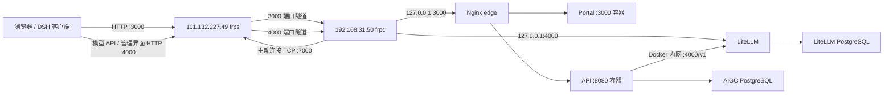

# demo 分支部署说明：AIGC、DSH 与 LiteLLM

本文供后续 agent 在更新 `D:\Code\Bosch\aigc` 的 `demo` 分支时读取，记录实际部署拓扑、地址约定、更新流程和验证要求。不要直接套用仓库中面向其他环境的 Compose 默认地址或 Kubernetes 部署脚本。

文档整理日期：2026-10-17。部署与端口验证基线：2026-10-16。2026-10-17 文档整理期间重新连接 `192.168.31.50` 时发生 SSH banner 握手错误，未完成当日在线复查；后续操作前必须重新检查实际状态。本文中的 `demo` 是用户指定的部署分支，不表示本次文档编写已切换或验证本地 Git 分支。

## 1. 两台服务器的职责

| 主机 | 职责 | 登录身份 | 关键目录/服务 |
|---|---|---|---|
| 阿里云 `101.132.227.49` | 公网入口，运行 frps，接收 Linux 主动建立的隧道；不承载此次 AIGC 应用和数据库 | SSH `root`，端口 `22` | `/root/frpc/frp`；`frps.service` |
| 局域网 `192.168.31.50`，主机名 `wh-test-server` | 运行 API、Portal、LiteLLM、两个 PostgreSQL、Nginx，并运行 frpc 连接阿里云 | SSH `bhsswh`，端口 `22`，具备 sudo 与 Docker 权限 | `/home/bhsswh/aigc/current`；Compose 项目 `aigc-wh`；`aigc-frpc.service` |
| 开发笔记本 | 源码修改、构建 Linux 镜像和 Windows DSH 安装包、传输交付物 | 本机用户 | `D:\Code\Bosch\aigc` |

业务运行不依赖笔记本：笔记本关机后，两台服务器之间的隧道应继续工作。不要重新让笔记本 frpc 抢占此次部署的远端端口。

服务器密码、frp token、数据库密码、JWT 密钥和 LiteLLM Master Key 不写入本文件或提交到 Git。SSH 凭据向用户获取；运行时密钥在应用服务器已有 `.env` 和 `frpc.toml` 中，读取时不要打印到日志。

## 2. 拓扑与端口



| 公网端口 | 所属程序 | 转发目标 | 用途 |
|---|---|---|---|
| `7000/TCP` | 云服务器 frps 控制连接 | Linux frpc 主动连接该端口 | 建立并维持隧道，不是业务 HTTP 入口 |
| `3000/TCP` | frps 代理 `aigc-portal-wh` | Linux `127.0.0.1:3000` → Nginx | AIGC 网站、AIGC API、DSH 登录/插件/文件/更新接口 |
| `4000/TCP` | frps 代理 `aigc-litellm-wh` | Linux `127.0.0.1:4000` → LiteLLM | 模型 API 与 LiteLLM 管理界面 |

云安全组和云防火墙需要放行上述端口；7000 来源可限制为应用服务器出口 IP，3000/4000 按用户实际访问范围设置。公网业务端口可以在 frpc 注册成功后才出现监听，不能仅凭业务端口未监听断定 frps 未启动。

早期诊断中公网 4000 未放行，因此曾暂用 `:3000/litellm/v1`。用户随后放行 4000，已恢复独立转发。**后续配置以 `:4000/v1` 为 LiteLLM 正式公网地址。**

## 3. 地址约定

| 用途 | 地址 |
|---|---|
| AIGC 网站 | `http://101.132.227.49:3000` |
| 工号密码登录 | `http://101.132.227.49:3000/login/local` |
| AIGC API 根地址 / DSH 托管后端根地址 | `http://101.132.227.49:3000` |
| API 健康检查 | `http://101.132.227.49:3000/health` |
| DSH 登录接口 | `POST http://101.132.227.49:3000/v1/auth/login` |
| LiteLLM 公网 OpenAI Base URL | `http://101.132.227.49:4000/v1` |
| LiteLLM 公网管理页 | `http://101.132.227.49:4000/ui/` |
| LiteLLM 公网健康检查 | `http://101.132.227.49:4000/health/liveliness` |
| LiteLLM 内网管理页 | `http://192.168.31.50:4000/ui/` |

用户明确选择 **IP + HTTP**，此次部署不配置域名或 HTTPS。不要自行把地址换回旧企业域名、`172.28.12.33`、开发笔记本 IP 或 `localhost`。DSH 账号使用 AIGC 的工号密码，LiteLLM 管理账号使用 `admin` 与已生成的 Master Key，两者不是同一套登录凭据。

## 4. 应用服务器配置与数据

操作主机：`192.168.31.50`，系统基线 Ubuntu 24.04、linux/amd64，已有 Docker Engine 与 Compose 插件。

当前入口 `/home/bhsswh/aigc/current` 是符号链接，首次部署指向 `/home/bhsswh/aigc/releases/20261016-wh.1`。修改前先执行 `readlink -f`，后续版本不能假设仍指向这个历史目录。

| 文件/服务 | 位置或说明 |
|---|---|
| Compose | `/home/bhsswh/aigc/current/compose.yaml`，项目名固定 `aigc-wh` |
| 运行时密钥 | 同目录 `.env`，权限 `600`，更新时保留原值 |
| LiteLLM 文件配置 | 同目录 `litellm-config.yaml` |
| Nginx 路由 | 同目录 `nginx.conf`，挂载到 edge 容器 `/etc/nginx/conf.d/default.conf` |
| frpc 程序与配置 | 同目录 `frpc`、`frpc.toml`，配置权限 `600` |
| frpc systemd 单元 | `/etc/systemd/system/aigc-frpc.service`，以 `bhsswh` 运行，`Restart=always`、开机启动 |
| 维护说明/验收记录 | 同目录 `DEPLOYMENT.md`、`verification.json`、`verification-4000.json` |

Compose 服务为 `api`、`portal`、`edge`、`litellm`、`postgres`、`litellm-postgres`，均设置 `restart: unless-stopped`。首次部署镜像如下，更新时使用新版本标签，不覆盖这些基线标签：

```text
aigc-api:2026-10-16-wh.1
aigc-portal:2026-10-16-wh.2
ghcr.io/berriai/litellm:v1.101.0
postgres:17-alpine
nginx:stable-alpine
```

宿主机端口：edge `3000:80`；API `5080:8080`；LiteLLM `4000:4000`；Portal 调试入口 `127.0.0.1:3002:3000`。数据库不发布宿主机端口。**公网不需要额外映射 5080**，API 已通过 edge 的 3000 入口访问。

Nginx 路由：`/api/`、`/v1/`、`/health`、`/hubs/` 转发至 `api:8080`；其他网站路径转发至 `portal:3000`。保留的 `/litellm/` 兼容路由去前缀后转发至 `litellm:4000`，不是新的客户端配置首选。保留流式响应禁用缓冲、长超时、WebSocket 支持和文件上传限制。

API 的关键运行时配置：

```yaml
LiteLlm__BaseUrl: http://litellm:4000/v1
LiteLlm__PublicBaseUrl: http://101.132.227.49:4000/v1
Cas__Enabled: "false"
Cas__PublicBaseUrl: http://101.132.227.49:3000
Cas__ServiceUrl: http://101.132.227.49:3000/v1/auth/cas/callback
Cors__Origins__0: http://101.132.227.49:3000
Cors__Origins__1: http://192.168.31.50:3000
```

`LiteLlm__BaseUrl` 是 API 在 Docker 网络中的服务地址；`LiteLlm__PublicBaseUrl` 是返回给 DSH 的外部模型连接地址。不要把这两个地址混用。Portal 必须在镜像构建时设置 `NEXT_PUBLIC_API_BASE_URL=http://101.132.227.49:3000`，仅修改容器启动环境不能替换已经打包进浏览器资源的地址。

持久化卷包括 `aigc-wh_postgres`、`aigc-wh_litellm-postgres`、`aigc-wh_plugins`、`aigc-wh_desktop-releases`、`aigc-wh_data-protection`、`aigc-wh_dsh-uploads`。不要变更 Compose 项目名、删除 volumes、执行 `down -v` 或重新生成已有 `.env`。不要修改主机已有的视觉推理、YOLO、MediaMTX 服务。

首次部署使用新数据库，没有迁移旧环境业务数据。AIGC 管理员工号为 `wh00028`，初始密码已随机生成；示例用户 `wh00136`、`wh00412` 已停用。LiteLLM 初始模型目录为空，用户明确选择后续自行接入；后续 agent 必须查询当前实际模型，不能继续假设为空。

## 5. frp 配置

两端使用 frp `0.61.0`。云服务器程序的真实目录是 **`/root/frpc/frp`**，虽然目录名带 frpc，但此处运行的是 frps。不要误写成 `/root/frp` 或 `/root/frps/frp`。

云服务器 systemd 的启动命令：

```text
ExecStart=/root/frpc/frp/frps -c /root/frpc/frp/frps.toml
```

历史错误是 ExecStart 指向不存在的 `/root/frp/frps`，导致 `203/EXEC`。已修正；原单元备份为 `/etc/systemd/system/frps.service.bak-20261016-1420`。

Linux `frpc.toml` 的结构如下，token 必须读取现有文件并保留，不能直接用此占位符覆盖线上配置：

```toml
serverAddr = "101.132.227.49"
serverPort = 7000
loginFailExit = false
auth.method = "token"
auth.token = "<保留现有 token，与 frps 一致>"

[[proxies]]
name = "aigc-portal-wh"
type = "tcp"
localIP = "127.0.0.1"
localPort = 3000
remotePort = 3000

[[proxies]]
name = "aigc-litellm-wh"
type = "tcp"
localIP = "127.0.0.1"
localPort = 4000
remotePort = 4000
```

服务端基线 `bindPort=7000`，token 认证开启，`allowPorts` 包含 3000、4000。不要为一般应用更新修改 frps、认证 token 或无关代理。

## 6. demo 分支更新流程

### 6.1 修改前确认

1. 阅读本文件及目标目录实际适用的 `AGENTS.md`，检查工作区已有修改。
2. 确认源码所在 Git 仓库当前分支是用户要求的 `demo`。AIGC 目录和嵌套 `deepseek-harness` 不能假设是同一个 Git 仓库；若 Git 无法识别，先定位正确 checkout，不要 `git init` 或强制切分支。
3. SSH 检查应用服务器当前 Compose、镜像、符号链接、服务健康与 frpc 映射；按任务范围备份配置和数据库。
4. 只修改本次任务需要的组件。不要重置用户源码、使用旧环境 `.env.production` 覆盖此环境配置或迁移企业生产数据。

### 6.2 构建 API 与 Portal（开发笔记本，PowerShell）

以下以发布标签 `demo-YYYYMMDD-N` 为占位符，执行前替换为本次唯一标签：

```powershell
Set-Location 'D:\Code\Bosch\aigc'
docker build --platform linux/amd64 -t aigc-api:demo-YYYYMMDD-N -f server/AigcHub.Api/Dockerfile server/AigcHub.Api
docker build --platform linux/amd64 --build-arg NEXT_PUBLIC_API_BASE_URL=http://101.132.227.49:3000 -t aigc-portal:demo-YYYYMMDD-N -f portal/Dockerfile portal
docker save --platform linux/amd64 -o aigc-demo-YYYYMMDD-N.tar aigc-api:demo-YYYYMMDD-N aigc-portal:demo-YYYYMMDD-N
Get-FileHash .\aigc-demo-YYYYMMDD-N.tar -Algorithm SHA256
```

构建前核对 Dockerfile 和 `.dockerignore`，不要将密钥、数据库、用户上传、DataProtection 或本机运行数据打进镜像。只更新一个组件时仅构建、传输该组件。按变更运行相关测试；构建成功不能替代线上验收。

### 6.3 部署更新（应用服务器，Bash）

传输镜像归档与校验和到应用服务器，确认校验值后导入。修改前保存原镜像标签及配置备份。以下流程针对现有部署的原地更新：

```bash
cd /home/bhsswh/aigc/current
readlink -f /home/bhsswh/aigc/current
docker compose ps
cp -a compose.yaml "compose.yaml.bak-$(date +%Y%m%d-%H%M%S)"
cp -a nginx.conf "nginx.conf.bak-$(date +%Y%m%d-%H%M%S)"
# 使用传入的校验文件核验归档，再导入：
docker load -i aigc-demo-YYYYMMDD-N.tar
# 将 compose.yaml 中本次需要更新的镜像改成新标签；保留项目名、环境变量及 volumes。
docker compose config --quiet
docker compose up -d --no-deps --pull never api portal
# 确认 API、Portal 已就绪后，让 Nginx 重新解析重建容器的地址。
docker compose exec -T edge nginx -t
docker compose exec -T edge nginx -s reload
```

只更新一个组件时，将上面的 `api portal` 缩小到对应服务。API 初始化数据库需要时间，刚启动的瞬间可能出现 502，应先看容器日志和服务就绪情况。应用更新通常无需重启 frpc。

如果采用新的 release 目录，必须同步复制所需配置并保留同一 Compose 项目与数据卷，核对 bind mount 实际指向；仅切换 `current` 符号链接不会自动重建挂载旧配置的容器。验证成功后再完成版本切换和记录更新。

### 6.4 LiteLLM 模型管理

使用公网 `http://101.132.227.49:4000/ui/` 或内网管理页添加上游模型；文件配置修改后执行 `docker compose restart litellm`。在 AIGC 模型管理中执行“同步 LiteLLM”，启用/发布模型并授予相应用户、角色或部门。DSH 通过 AIGC 获取用户模型与凭据，普通用户不要使用 LiteLLM Master Key。

已有模型可能由管理页存入数据库，不能只看 `litellm-config.yaml` 判断模型配置是否为空。保留 LiteLLM 数据库及 `LITELLM_SALT_KEY`，不要在应用更新时重新生成密钥。

### 6.5 DSH 客户端打包

源码位于 `D:\Code\Bosch\aigc\deepseek-harness`。已交付版本 `0.1.7-alpha.2.20261016.2` 的 Windows 安装包固定封装后端 `http://101.132.227.49:3000`，其更新地址为 `http://101.132.227.49:3000/v1/desktop/updates/`。旧客户端可能仍封装企业域名，机器级环境变量无法覆盖已安装包的地址。

此次修改过 `apps/desktop/scripts/desktop-managed-backend.mjs`、`apps/desktop/src/managed-backend-environment.ts` 的指定 HTTP 地址校验，对应测试和中英文 README；API/Portal 业务源码未因此次部署修改。HTTP 放行范围限定在已批准部署地址，不允许为了打包全局取消地址校验。

打包读取 `apps/desktop/.env.windows`，其原文件在本次打包后已恢复，**后续打包不能假设其仍配置 demo 公网地址**。新包若需要连接本环境，应备份该文件、设置 `DSH_DESKTOP_MANAGED_BACKEND_URL=http://101.132.227.49:3000`，按仓库脚本构建，结束后按用户要求恢复配置并核验包内地址。

```powershell
Set-Location 'D:\Code\Bosch\aigc\deepseek-harness'
pnpm.cmd exec vitest run apps/desktop/tests/managed-backend-package.spec.ts --maxWorkers=4
pnpm.cmd run package:desktop:win:x64:unsigned -- --build-version auto
```

产物目录为 `apps/desktop/.desktop-build/targets/win-x64/unsigned-artifacts`。验证安装包版本、manifest 后端地址、更新地址、SHA256 和实际安装/登录行为。未签名包要如实标注，不得宣称具备签名或已消除 SmartScreen 提示；保留客户端原有安全退出与升级流程。仅服务器代码更新、后端根地址不变时，不必重新打包 DSH。

## 7. 验收和故障排查

应用服务器执行：

```bash
cd /home/bhsswh/aigc/current
docker compose ps
docker compose logs --tail 100 api portal litellm edge
systemctl is-active aigc-frpc
systemctl is-enabled aigc-frpc
journalctl -u aigc-frpc -n 30 --no-pager
curl -f http://127.0.0.1:3000/health
curl -f http://101.132.227.49:3000/health
curl -f http://101.132.227.49:4000/health/liveliness
```

云服务器执行：

```bash
systemctl status frps --no-pager
journalctl -u frps -n 30 --no-pager
ss -lntp | grep -E ':(7000|3000|4000)\b'
```

还需在服务器外验证网页、登录、DSH 身份查询、插件/文件接口及实际模型调用。LiteLLM 带有效密钥的 `/v1/models` 应成功，无凭据应返回 401。不要在命令历史、截图和输出中泄露 token。

| 症状 | 优先检查 |
|---|---|
| frps 报 `203/EXEC` | systemd ExecStart 的程序/配置路径是否真实存在 |
| frpc 7000 连接超时 | Linux 出网、云安全组/云防火墙、frps 控制端口监听 |
| 代理注册成功但公网业务超时 | 对应 3000 或 4000 是否在云安全组放行 |
| 3000 访问 502 | API/Portal 是否就绪，Nginx upstream 是否仍缓存旧容器 IP |
| 网站页面可打开但 API 仍请求旧地址 | Portal 镜像的构建参数和浏览器实际请求地址 |
| DSH 登录访问旧企业地址 | 是否安装了正确环境的新包，检查封装的后端 origin |
| DSH 有模型但调用失败 | AIGC 返回的公网 Base URL、模型授权、用户 Virtual Key、上游模型实际可用性 |

2026-10-16 已验证：公网网站、API 健康、AIGC 登录和身份、DSH 登录和身份、插件策略、模型目录、AIGC→LiteLLM 同步、4000 健康与 UI、LiteLLM 认证。DSH 包的 12 项地址测试、运行时和 Office 转换检查通过。实际 Windows 安装升级、GUI 登录及真实上游模型推理当时未验收，不能据此宣称通过。

## 8. 回退与交接

更新回退：恢复原 `compose.yaml` 的镜像标签及必要配置，重新启动受影响服务并 reload edge，再执行健康与公网验证。数据库结构变更必须先评估向后兼容性，必要时使用此次更新前的数据库备份；不要只换旧镜像就假定数据兼容。

首次部署整体停用：在本项目目录执行 `docker compose down`，并 `sudo systemctl stop aigc-frpc`，保留所有数据卷和密钥。不得影响同机其他 Compose 项目或执行主机级清理命令。

后续每次变更完成后，更新本文件中的当前目录、镜像版本、端口、地址和验收日期/结果。记录“构建完成”“已部署”“公网已验证”“模型推理已验证”的各自状态，不要互相替代；不要把凭据写进文档。
