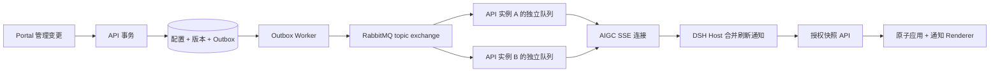

# AIGC / DSH 配置热更新方案

日期：2026-11-03。状态：初始设计。模型、倍率、配方的版本通知、设备回执及状态页面已在源码中实现；实际协议、限制和部署步骤以 [部署说明](DSH-CONFIG-HOT-UPDATE-DEPLOYMENT.md) 为准，尚未部署生产。插件/MCP 的主动同步唤醒仍属于后续扩展。

## 推荐架构

采用 PostgreSQL 配置及版本为事实源、事务 Outbox 保证变更事件最终发布、现有 RabbitMQ 在服务端分发、AIGC HTTPS SSE 通知 DSH Host、客户端按版本重拉受授权配置并原子替换。客户端不直连 AMQP，不持有 MQ 凭据，不安装插件来完成配置热更新。

SSE 用于服务器到客户端的单向失效提示。DSH Host 使用 fetch 流式读取并携带现有 Authorization header；不要把 bearer token 放进 URL，也不要由每个窗口单独创建外网连接。复用 Host 到 Renderer 的既有远程事件通道。现有 SignalR 用于 Portal 通知，DSH 不必为此新增 SignalR 客户端或 Redis backplane。

## 已核对的现状

- `llm-managed-backend/src/index.ts` 的 `resolveModel`、`prepareCall` 每次读取 `/v1/models`，不是仅登录时读取。模型列表、能力、倍率的 UI 缓存仍需要主动失效通知。
- `ui-model-selection/src/client/service.ts` 已监听 `llm/adapters-updated` 等事件，可复用目录失效路径，但需要确认 Host 的触发入口，不伪造无关的凭据变更事件。
- `TokenBillingService.ReserveAsync` 从服务端模型配置取倍率写入计费记录；`SettleAsync` 使用该记录里的倍率，不依赖客户端提交倍率。
- 账号额度 UI 现有 15 秒轮询；托管插件另有周期同步和身份变化唤醒。尚没有覆盖所有配置域的远程变更通知。
- 用户同步已有 Outbox、版本、publisher confirms、mandatory、重试等实现。复用设计及底层连接管理思路；另建配置事件协议，不将配置事件塞进语义为用户同步的表。
- 当前模型请求存在直连后端提供的模型连接参数的路径。即时撤权不能仅依赖 DSH 界面刷新，仍须 LiteLLM/实际模型服务在请求入口执行授权、密钥失效和限额策略。

## 配置域与生效语义

| 变更 | 客户端刷新 | 生效边界 |
| --- | --- | --- |
| 模型增删、启停、授权、能力 | 模型目录及选择器 | 下一次请求重新授权；删除当前模型后标为不可用并要求重新选择，不悄悄切换付费模型 |
| 模型倍率 | 目录倍率标识、计费说明 | 新建计费记录使用新倍率；进行中的请求使用预占记录中的旧倍率 |
| 计费配方、个人/部门归属、增量包 | 有效配方、额度及重置时间 | 下一次准入按服务器最新规则校验；历史账单不重算 |
| 账号停用、撤销访问 | 清除相应缓存和会话状态 | 后端/模型服务拒绝新请求；是否中止已有流作为独立安全策略，不能把界面同步等同于中止能力 |
| 插件及 MCP 策略 | 唤醒原同步器，按需扩展 | 仅支持热加载的配置直接应用；代码变更仍遵守现有 RestartRequired 语义 |

配方切换仍保留个人覆盖部门的现有优先级。热更新不清空本周用量、不重置结算待上报记录。每次结算产生的额度展示变更可以聚合推送，避免高频 token 逐条广播。

## API 和版本协议

建议新增：

- `GET /v1/config/events`：现有 DSH 会话鉴权，SSE，仅发送用户可见范围的变更提示、心跳、重同步要求。
- `GET /v1/config/versions`：轻量核对当前用户有效配置版本，支持 ETag；不是直接使用不含用户范围的全局 ETag。
- `GET /v1/config/snapshot`：返回当前用户已授权的模型元信息、有效计费/配方信息及版本向量。敏感连接凭据不放进广播事件；沿用专门的授权获取路径。
- `POST /v1/config/applied`：可选，报告 deviceId、客户端版本、已应用版本及失败域，供管理端观测；不能将客户端上报当作服务端安全授权依据。

事件字段建议为 eventId、schemaVersion、scope、domains、revision、occurredAt。MQ 中允许出现必要的目标用户/部门标识，但不得包含 Key、完整用户列表或整份配置；客户端 SSE 事件只携带属于当前身份的必要信息。

版本必须在配置变更的同一数据库事务里推进，和 Outbox 一起提交。使用按配置域递增、由数据库事务保证顺序的版本，避免拿时间戳或“最大事件 ID”冒充提交顺序。部门成员、角色、用户/部门分配变更均纳入依赖域失效。并发构建快照时，使用一致性读取或读版本—取数据—再读版本并重试，避免新版本标签配旧配置。

DSH 仅在完整快照校验、应用成功后更新 lastApplied；失败保留旧版本并重试。连接账号或组织切换时取消旧请求、清除旧作用域版本，防止迟到响应覆盖新账号。

## RabbitMQ 拓扑及可靠性

### 与现有部署对齐

已核对 `DEPLOYMENT-RUNBOOK.md` 的 2026-11-02 with-mq 部分、`deploy/nj304-rabbitmq/prepare.py` 和 `docs/USER-SYNC-RABBITMQ.md`：部署位置为 nj304，Kubernetes Service 为 `aigc-mq`，AMQP 端口 5672，vhost `/aigc`。这是仓库中的部署配置证据；服务器已部署由用户确认，本次未登录集群核验实时状态。

现有三账号是：

| 账号 | 当前配置的职责 |
| --- | --- |
| `aigc_mq_admin` | `/aigc` 内管理、配置、读写；仅供运维维护拓扑 |
| `aigc_user_producer` | 只允许向 `aigc.identity.users` 写入，无配置和读取权限 |
| `aigc_user_service_1` | 只允许读取 `aigc.users.service-1`，无配置及写入权限 |

密码由 `MQ_ADMIN_PASSWORD`、`MQ_PRODUCER_PASSWORD`、`MQ_CONSUMER_PASSWORD` 提供，或在部署准备阶段生成并由运维保存。AIGC 当前生产账号密码通过既有 `aigc-secrets` 的 `UserSync__Password` 注入；新功能也沿用 Secret 注入方式，不将密码写入文档、事件或客户端。

热更新复用同一个 RabbitMQ 实例和 `/aigc`，独立配置 exchange 和连接选项，不复用用户同步队列。推荐由运维使用现有管理账号创建配置热更新专用运行账号，最小权限覆盖配置 exchange 的发布、消费及实例队列声明/绑定/删除。管理账号不进入 API 运行配置，原用户生产/消费账号不改变职责。如果必须保留三账号，也可经授权扩展生产账号的配置事件权限，但这会扩大其现有职责，不应默认执行。

采用每实例短生命周期队列时，运行账号必须有受队列前缀限制的 configure 权限以及 RabbitMQ 绑定所需的 exchange/queue read/write 权限；不能直接使用当前 `configure=^$` 的生产或消费账号期待自动建队列成功。另一选择是由运维预建固定实例队列并分配窄权限，但动态扩缩容会更复杂。新增队列和权限通过部署脚本/运维命令维护，不放进 AIGC 管理 UI。

- 复用服务器现有 RabbitMQ，另建配置 topic exchange，例如 `aigc.config.events`；路由键区分 model、billing、access 等域，具体环境名通过配置传入，不写死 localhost。
- 每个在线 API 实例有独立绑定队列，才能把变更传到所有实例上的客户端。多个 API 共享一个工作队列会竞争消费，无法保证每个连接所在实例收到通知。
- 在线失效提示可使用 exclusive/auto-delete 的实例队列，数据库配置和版本负责持久事实及补偿；实例重新绑定后必须主动对本机全部连接发 resync。需要独立持久审计时另设审计队列，不能将临时队列误当离线客户端邮箱。
- Outbox 发布使用 confirms，按需使用 mandatory 检测无路由；重试有退避、告警和人工重放。消费者处理后 ack，重复投递靠 eventId/版本幂等。
- MQ 确认不等于 DSH 已应用。在线客户端成功率以 applied revision 衡量。
- 单节点 RabbitMQ 不能因使用 quorum queue 就获得跨节点高可用；是否建设集群需按服务器实际部署评估。

## 断线及多实例

客户端登录/启动、SSE 重连、系统恢复、网络恢复后都先核对有效版本；连接建立后再做一次核对，关闭“取完快照才开始订阅”的丢事件窗口。只要版本不一致就拉最新快照，不要求无限保留或逐条重放每一个通知。

SSE 断线按指数退避并加随机抖动重连，建议心跳 20–30 秒；弱网或事件通道不可用时建议每 60–120 秒带抖动核对版本。具体时间是待压测的初始参数。MQ 连接恢复后每个 API 实例重新核对并通知本机客户端；后台也可周期核对版本，覆盖 MQ 消息丢失但 SSE 仍在线的情形。

每个 DSH Host 单连接、每个用户所有设备均通知。连续变更合并 200–500ms，按域 single-flight 刷新，刷新中再次失效则完成后补拉。慢客户端只保留最新失效状态，队列有界；积压时发 resync，而不是无限缓存每条事件。

授权撤销必须覆盖变更前、后用户集合的并集。不能只按修改后的部门/角色成员通知，否则已移出的用户收不到失效提示。第一阶段可对连接广播无敏感内容的域级失效，由每个用户重新获取其受授权快照，再按规模优化目标分发。

代理需关闭 SSE 响应缓冲、配置合理读超时、保持流式 flush。用户登录令牌不进入 URL/访问日志。多实例 SSE 每条连接固定在承载它的 API 即可，快照请求可路由到其他实例；数据/版本必须来自共享数据库。

## 分阶段落地与验收

1. 建立版本/Outbox 和现有变更入口的覆盖矩阵，包括批量同步模型、授权、倍率、配方、分配、成员变化和增量包；无效更改或回滚不发事件。
2. 上线 MQ 消费和 SSE，接入 DSH Host 的统一刷新服务；先覆盖模型/倍率/配方，再扩展 MCP/插件。
3. 增加重连补偿、限流和应用版本报告，管理端展示在线设备及落后版本。

验收覆盖：跨 API 实例、同用户多设备、MQ 停启、客户端离线、事件重复/乱序、身份切换、连续修改、撤权旧成员、请求执行中修改倍率、跨周重置、配方降低但已有结算记录、慢客户端和上千连接压测。

健康内网端到端刷新目标可设为 1–3 秒；这是待验证目标，不是当前能力或无条件承诺。断线客户端只承诺恢复连接后最终收敛。不能用配置刷新代替服务端每次请求的计费及授权检查。

参考：[RabbitMQ exchanges](https://www.rabbitmq.com/docs/exchanges)、[publisher confirms 与 consumer acknowledgements](https://www.rabbitmq.com/docs/confirms)、[SSE](https://developer.mozilla.org/en-US/docs/Web/API/Server-sent_events/Using_server-sent_events)。
