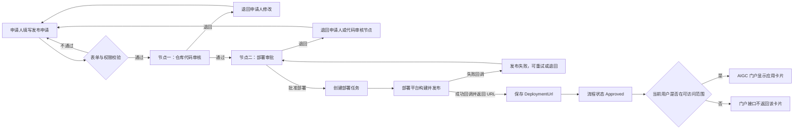
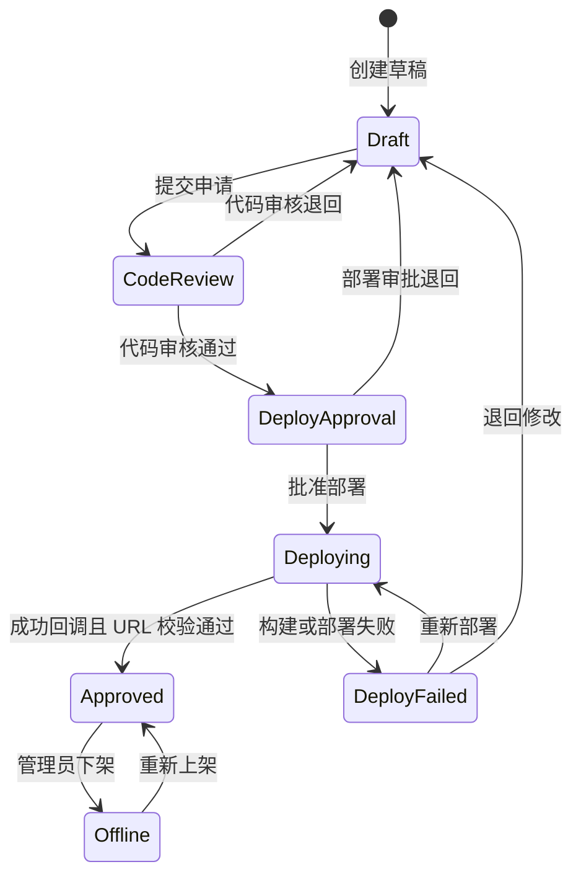
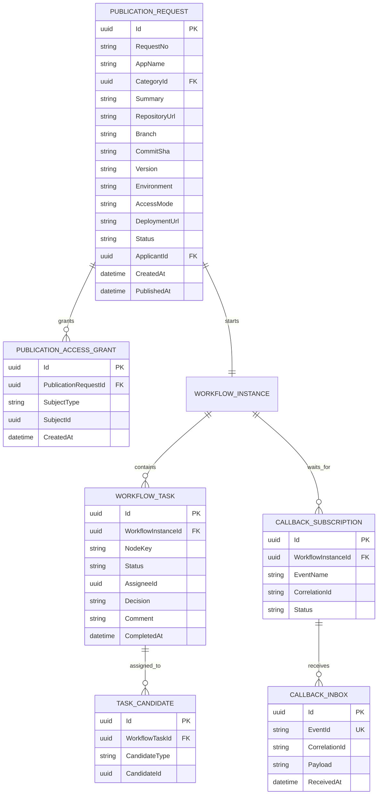
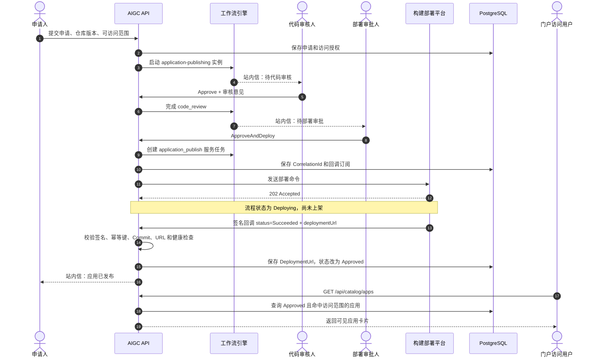
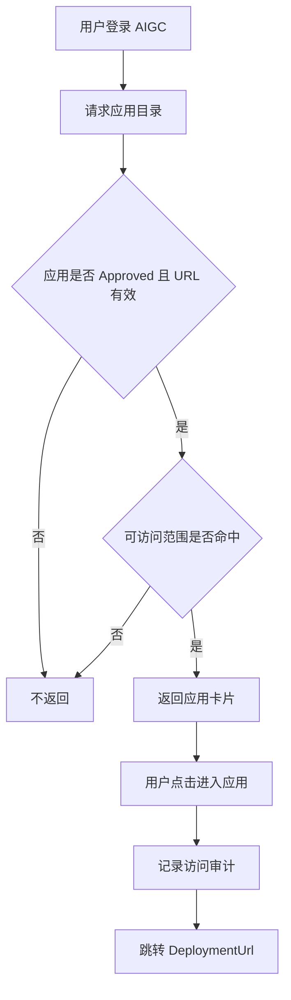
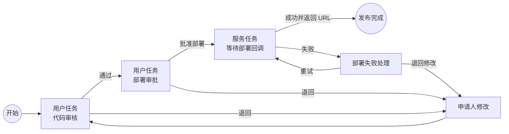

# AIGC 应用发布审批流程设计

> 文档状态：目标方案（待按本文实施）  
> 适用范围：应用发布申请、代码审核、部署审批、部署回调、门户应用卡片可见性  
> 核心原则：审批资格、流程状态和应用可见性均由后端判定，前端只根据后端返回结果展示操作入口。

## 1. 目标与现状差异

当前项目的流程是：申请人提交应用及访问地址，单个审批节点审核通过后进入发布服务任务，发布系统回调成功后将申请置为 `Approved`。

目标流程调整为：

1. 申请人提交应用资料、代码仓库信息和可访问范围，申请阶段不填写最终部署 URL。
2. 审批节点一审核指定仓库、分支及提交版本的代码。
3. 审批节点二授权部署；部署系统完成后通过签名回调返回最终 URL。
4. 只有流程完全通过且当前登录用户命中可访问范围时，门户才返回并显示该应用卡片。

## 2. 总体流程图



## 3. 状态机



建议使用以下状态值：

| 状态 | 含义 | 门户是否可见 |
| --- | --- | --- |
| `Draft` | 草稿或被退回待修改 | 否 |
| `CodeReview` | 等待代码审核 | 否 |
| `DeployApproval` | 代码审核通过，等待部署审批 | 否 |
| `Deploying` | 已批准，等待部署系统回调 | 否 |
| `DeployFailed` | 部署失败，可重试或退回 | 否 |
| `Approved` | 部署成功且发布完成 | 按可访问范围判断 |
| `Offline` | 已下架 | 否 |

## 4. 发布申请表单

### 4.1 表单字段

| 分组 | 字段 | 数据类型 | 必填 | 来源/规则 | 示例 |
| --- | --- | --- | --- | --- | --- |
| 基本信息 | `appName` | `string(100)` | 是 | 应用名称，同一环境下建议唯一 | 质量知识助手 |
| 基本信息 | `categoryId` | `uuid` | 是 | 从已启用分类中选择 | `8f...` |
| 基本信息 | `summary` | `string(500)` | 是 | 用于门户卡片简介 | 快速检索质量规范与案例 |
| 基本信息 | `icon` | `string` | 否 | 图标资源标识或上传后的资源 ID | `quality-agent` |
| 代码信息 | `repositoryUrl` | `string(500)` | 是 | 仅允许公司批准的 Git 域名 | `https://git.example.com/aigc/quality-agent` |
| 代码信息 | `branch` | `string(100)` | 是 | 待审核分支 | `release/1.2.0` |
| 代码信息 | `commitSha` | `string(64)` | 是 | 必须锁定具体提交，不接受只填分支 | `9c31e7...` |
| 代码信息 | `version` | `string(50)` | 是 | 发布版本 | `1.2.0` |
| 部署信息 | `environment` | `enum` | 是 | `Test`、`Staging`、`Production` | `Production` |
| 部署信息 | `healthCheckPath` | `string(200)` | 否 | 部署后健康检查路径 | `/health` |
| 访问控制 | `accessMode` | `enum` | 是 | `All` 或 `Subjects` | `Subjects` |
| 访问控制 | `accessSubjects` | `array` | 条件必填 | 当 `accessMode=Subjects` 时至少选择一项 | 见下文 |
| 联系信息 | `ownerId` | `uuid` | 是 | 默认申请人，可改为其他责任人 | 当前用户 ID |
| 联系信息 | `technicalContactIds` | `uuid[]` | 否 | 技术联系人，可多选 | 用户 ID 列表 |
| 系统字段 | `applicantId` | `uuid` | 自动 | 从登录令牌读取，禁止客户端伪造 | 当前用户 ID |
| 系统字段 | `applicantDepartmentId` | `uuid` | 自动 | 从用户资料读取 | 部门 ID |
| 系统字段 | `deploymentUrl` | `string(500)` | 回调填写 | 申请阶段只读，部署成功后写入 | `https://quality-ai.example.com` |

### 4.2 “可访问人”属性设计

前端字段名称使用“可访问范围”，交互采用支持搜索的多选人员选择器，选项可包含人员、部门和角色。后端不保存姓名等易变展示文本作为权限依据，而保存稳定标识。

```json
{
  "accessMode": "Subjects",
  "accessSubjects": [
    {
      "subjectType": "User",
      "subjectId": "9ab62c47-30c9-4b67-88e8-8bb0ff7eea10",
      "displayName": "王小明"
    },
    {
      "subjectType": "Department",
      "subjectId": "13ca95a0-e013-4a90-861a-9da8140113bd",
      "displayName": "质量管理部"
    },
    {
      "subjectType": "Role",
      "subjectId": "c803126a-7407-4618-aed6-b2fced5a7bd5",
      "displayName": "质量工程师"
    }
  ]
}
```

权限命中规则：

- `accessMode=All`：所有已登录用户可见。
- `accessMode=Subjects`：当前用户命中任一人员、所属部门或角色即可见。
- 具体人员以用户 ID 匹配；部门和角色在每次查询时根据当前组织关系计算。
- 应用卡片查询必须由后端过滤，禁止只依赖前端隐藏。
- 被禁用用户即使仍在授权记录中也不能访问。

### 4.3 推荐的数据表



`displayName` 只用于提交回显或审计快照；鉴权必须使用 `subjectId`。建议将授权对象独立存入 `PublicationAccessGrant`，不要把逗号分隔的用户姓名写进 `PublicationRequest`。

## 5. 审批节点一：审核仓库代码

### 5.1 节点定义

| 项目 | 设计 |
| --- | --- |
| 节点键 | `code_review` |
| 节点类型 | `UserTask` |
| 候选人 | 流程设计器配置的代码审核用户、角色或部门 |
| 输入 | 仓库地址、分支、提交 SHA、版本、申请说明 |
| 操作 | `Approve`、`Reject` |
| 输出 | 审核结论、审核意见、审核人、审核时间、已审核 Commit SHA |
| 通过后 | 创建节点二 `deploy_approval` |
| 退回后 | 状态回到 `Draft`，通知申请人修改 |

### 5.2 审核页面必须展示

- 仓库、分支、Commit SHA 和版本号，仓库链接在新窗口打开。
- CI 构建状态、单元测试结果、依赖/漏洞扫描结果；暂未接入时明确显示“未接入”，不能默认显示通过。
- 应用基本信息和可访问范围摘要。
- 审核检查项：代码可维护性、敏感信息、依赖风险、许可证、接口安全、部署说明。
- 审核意见必填；退回时必须填写原因。

### 5.3 权限规则

- 只有后端计算出的候选用户才能处理任务。
- 申请人不能审核自己的申请。
- 审批提交时再次校验任务仍为 `Pending`，使用并发令牌防止重复审批。
- 页面按钮只根据接口返回的 `availableActions` 渲染，但后端仍必须执行完整授权校验。
- 节点一通过后锁定 `commitSha`；申请人修改仓库、分支或提交版本后，必须重新走代码审核。

## 6. 审批节点二：部署审批与 URL 回填

节点二是一个“人工授权 + 异步部署结果”的复合阶段：部署负责人先批准部署，工作流随后进入等待回调状态；部署系统成功后回传最终 URL，流程才真正通过。

### 6.1 节点定义

| 项目 | 设计 |
| --- | --- |
| 节点键 | `deploy_approval` |
| 节点类型 | `UserTask`，通过后衔接 `ServiceTask` |
| 候选人 | 流程设计器配置的发布管理员用户、角色或部门 |
| 输入 | 节点一结论、已审核 Commit SHA、目标环境、版本、健康检查配置 |
| 操作 | `ApproveAndDeploy`、`Reject` |
| 服务任务键 | `application_publish` |
| 回调事件 | `application-publish` |
| 成功输出 | `deploymentUrl`、`artifactVersion`、`commitSha`、`deployedAt` |
| 失败输出 | 错误码、错误信息、构建/部署日志地址 |

### 6.2 回调时序图



### 6.3 部署成功回调示例

沿用当前项目的签名回调机制，扩展 `data` 内容：

```http
POST /api/workflow/callbacks/application-publish HTTP/1.1
Content-Type: application/json
X-Callback-Timestamp: 1789093800
X-Callback-Signature: sha256=<hmac-sha256-signature>
```

```json
{
  "eventId": "deploy-20260911-000128",
  "correlationId": "6daee55e-0e55-4af0-929f-641456291cbc",
  "status": "Succeeded",
  "data": {
    "deploymentUrl": "https://quality-ai.apps.bhss.example.com",
    "environment": "Production",
    "artifactVersion": "1.2.0",
    "commitSha": "9c31e73d6b19381f1ed4bf8273e7f739951a9a62",
    "healthCheckUrl": "https://quality-ai.apps.bhss.example.com/health",
    "deployedAt": "2026-09-11T10:30:00+08:00"
  }
}
```

### 6.4 回调验收条件

只有同时满足以下条件，流程才能从 `Deploying` 进入 `Approved`：

1. `X-Callback-Signature` 和时间戳校验通过。
2. `eventId` 未处理过；重复事件返回幂等成功，不重复推进流程。
3. `correlationId` 对应当前实例正在等待的回调订阅。
4. `status=Succeeded`。
5. 回传 `commitSha` 与节点一审核通过的提交一致。
6. `deploymentUrl` 为 HTTPS，域名命中允许列表，且不能指向本机或内网保留地址绕过规则。
7. 健康检查成功；失败时保存失败原因并进入 `DeployFailed`。
8. 在同一数据库事务内保存 URL、完成服务任务并更新申请状态，避免“已通过但没有 URL”。

回调失败时不得展示应用卡片。失败原因和部署日志地址应写入流程变量，并向申请人与部署负责人发送站内信。

## 7. 审核通过后的门户应用卡片

### 7.1 服务端查询条件

`GET /api/catalog/apps` 的结果应满足：

```text
Publication.Status == Approved
AND Publication.DeploymentUrl IS NOT NULL
AND (
    AccessMode == All
    OR 当前用户 ID 命中 User 授权
    OR 当前用户部门 ID 命中 Department 授权
    OR 当前用户任一角色 ID 命中 Role 授权
)
```

接口只返回当前用户可以访问的应用，不能将全部应用发给浏览器后再做过滤。

### 7.2 卡片字段与行为

| 卡片内容 | 数据来源 | 行为 |
| --- | --- | --- |
| 应用名称 | `appName` | 显示完整名称，过长省略并提供提示 |
| 分类与主题色 | 分类表 | 支持分类筛选 |
| 简介 | `summary` | 最多显示两至三行 |
| 图标 | `icon` | 缺失时使用分类默认图标 |
| 版本 | `artifactVersion` 或申请版本 | 用于定位线上版本 |
| 负责人 | `ownerId` 对应用户 | 展示姓名，不暴露内部 ID |
| 上架时间 | `publishedAt` | 按用户时区格式化 |
| 进入应用按钮 | `deploymentUrl` | 新窗口打开；服务端应提供访问审计 |



## 8. 操作按钮与流程权限

| 页面/阶段 | 操作 | 展示条件 | 后端校验 |
| --- | --- | --- | --- |
| 发布申请 | 提交申请 | 用户拥有 `publication.create` | 当前用户有效、表单完整、仓库与访问范围合法 |
| 代码审核 | 通过/退回 | `availableActions` 包含对应动作 | 当前用户是节点一候选人且不是申请人 |
| 部署审批 | 批准部署/退回 | `availableActions` 包含对应动作 | 当前用户是节点二候选人、代码已通过、Commit 未变化 |
| 部署失败 | 重新部署 | `availableActions` 包含 `RetryDeploy` | 当前用户具有部署权限且实例状态为 `DeployFailed` |
| 门户卡片 | 进入应用 | 目录接口返回该卡片 | 再次校验状态与访问范围并记录审计 |

建议职责分离：申请人不能处理任一审批节点；默认情况下节点一审核人与节点二部署审批人也不应是同一人。若业务确需允许，由流程定义显式配置，不在前端写死。

## 9. 接口调整清单

| 接口 | 调整内容 |
| --- | --- |
| `POST /api/publication-requests` | 增加仓库、分支、Commit、版本、环境、`accessMode`、`accessSubjects`；移除申请人填写最终访问 URL |
| `GET /api/publication-requests/{id}` | 返回两个审批节点、部署状态、回调结果及访问范围摘要 |
| `POST /api/workflow/tasks/{id}/complete` | 支持 `Approve`、`Reject`、`ApproveAndDeploy`，仍以服务端 `availableActions` 为准 |
| `POST /api/workflow/callbacks/application-publish` | 从 `data` 读取并校验 `deploymentUrl`、Commit、版本、环境与健康检查结果 |
| `GET /api/catalog/apps` | 只返回 `Approved`、URL 有效且当前用户被授权的卡片 |
| `GET /api/directory/subjects` | 为“可访问范围”多选框提供人员、部门和角色的远程搜索 |

## 10. 站内信事件

| 事件 | 接收人 | 内容摘要 |
| --- | --- | --- |
| 申请已提交 | 申请人 | 申请编号和当前节点 |
| 待代码审核 | 节点一候选人 | 应用、仓库、Commit 和待办入口 |
| 代码审核退回 | 申请人 | 审核意见和修改入口 |
| 待部署审批 | 节点二候选人 | 代码审核结论、版本和环境 |
| 部署失败 | 申请人、部署负责人 | 错误原因和日志入口 |
| 发布成功 | 申请人、应用负责人 | 最终 URL、版本和上架时间 |

候选组通知应按用户展开生成个人站内信；用户登录后只读取自己的消息。任务被一人处理后，同组其他人的待办应同步失效。

## 11. 关键验收场景

1. 申请表未选择任何可访问对象且 `accessMode=Subjects` 时不能提交。
2. 节点一只能由流程配置的候选人处理，申请人不能自审。
3. 节点一通过后修改 Commit，原审核结论失效并重新进入代码审核。
4. 节点二批准后，在成功回调到达前应用保持 `Deploying`，门户不可见。
5. 成功回调不带 `deploymentUrl`、URL 非 HTTPS 或 Commit 不一致时，流程不得通过。
6. 相同 `eventId` 重复回调不会创建重复任务或重复通知。
7. 被授权个人可看到卡片，未授权个人看不到。
8. 用户因部门或角色命中授权时可看到卡片；移出部门或角色后刷新即不可见。
9. `Approved` 应用被下架后，所有用户的目录接口都不再返回它。
10. 用户直接构造 URL 访问目录或审批接口时，后端仍能阻止越权。

## 12. 与当前代码的实施映射

| 当前模块 | 需要实施的变化 |
| --- | --- |
| `PublicationRequest` | 增加仓库、版本、环境、部署 URL 字段；将当前提交时的 `AccessUrl` 改为回调写入的 `DeploymentUrl` |
| `SubmitPublicationRequest` | 接收仓库信息和访问范围，不再接收最终部署 URL |
| `WorkflowService.SubmitAsync` | 创建 `code_review` 任务并持久化访问授权 |
| `WorkflowService.CompleteTaskAsync` | 按节点推进到 `deploy_approval` 或发布服务任务，保留后端候选人校验和禁止自审 |
| `WorkflowService.ReceiveCallbackAsync` | 解析并校验回调 `data`，保存部署 URL 后才能置为 `Approved` |
| `CatalogEndpoints` | 在现有 `Approved` 条件上增加 URL 有效性和人员/部门/角色访问过滤 |
| 流程种子/流程设计器 | 默认定义改为：开始 → 代码审核 → 部署审批 → 发布回调 → 结束 |
| 发布申请与审核页面 | 增加仓库版本、可访问范围、双节点审核信息、部署等待和失败重试状态 |

最终流程定义应为：



