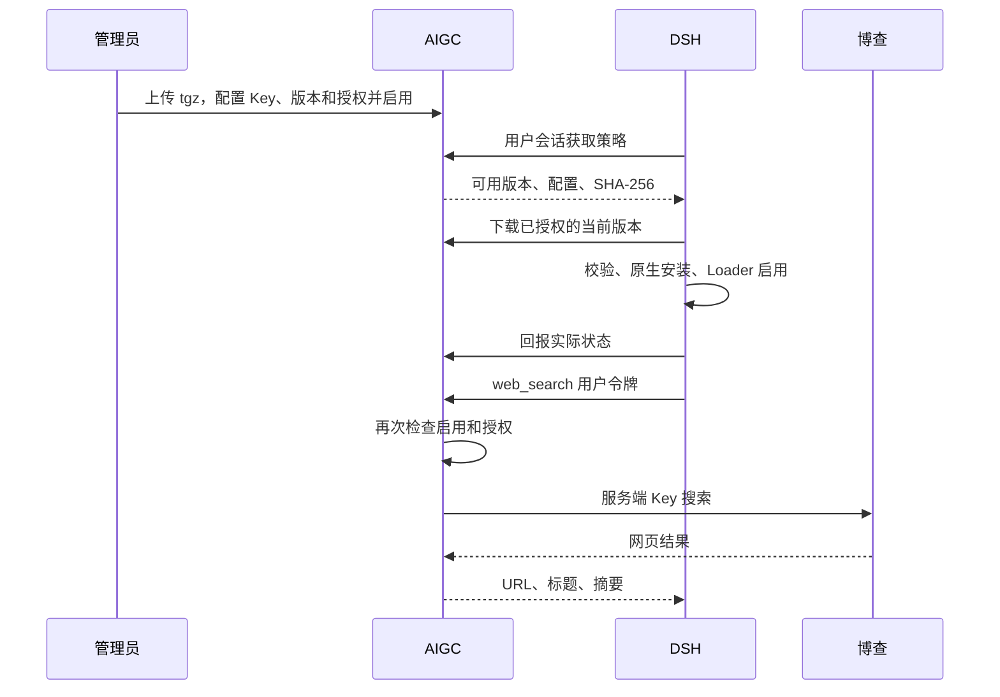

# AIGC 插件市场与 DSH 托管插件

## 责任和数据流

AIGC 管理插件包、不可变版本、当前发布版本、配置、启用状态、用户/角色/部门授权和客户端状态。DSH 复用原生 Profile、bundle patch、plugin-manager、Loader 与 HMR 执行安装和启停。插件独立放在 `plugins/`，不把博查业务代码嵌入 DSH。LiteLLM 的现有模型调用链保持独立。

此次落地的是企业内部插件市场：管理员上传和发布，授权用户的 DSH 自动获取。包含版本切换与客户端回报；不包含公共商店、第三方开发者审核和插件代码沙箱。

## 启用流程

1. 发布本次 AIGC 服务端和门户，重新构建并安装本次 DSH 客户端；旧客户端没有自动同步能力。数据库启动时按既有初始化机制增加插件表及 `plugin.manage` 权限。
2. 构建 `plugins/dsh-plugin-managed-search` 并上传生成的 tgz；入口为 `/admin/plugins`。新插件默认停用。
3. 选择发布版本，输入博查 Key，选择用户/角色/部门授权；配置 JSON 默认 `{}` 即可。保存并启用。
4. 在组织模式 DSH 登录。默认 60 秒同步，登录凭据变化会唤醒同步。在市场状态表检查实际版本、策略修订号和更新时间。
5. 发起需要联网的问题，核对真实 `web_search` 结果与来源。关闭或撤回授权后再次搜索应被拒绝，客户端下一次同步移除 provider。切换已有包版本如显示待重启则重启 DSH。

## 接口

| 调用者 | 接口 | 功能 |
|---|---|---|
| 管理端 | GET /api/plugins/ | 列表、版本、配置、授权 |
| 管理端 | POST /api/plugins/upload | multipart 的 package 字段上传 tgz |
| 管理端 | PUT /api/plugins/{id}/policy | 发布、启停、配置及授权 |
| 管理端 | GET /api/plugins/reports | 最近 500 条设备状态 |
| DSH | GET /v1/plugins/policy | 当前用户生效策略 |
| DSH | GET /v1/plugins/{id}/versions/{versionId}/package | 当前已授权版本下载 |
| DSH | POST /v1/plugins/reports | 设备状态回报 |
| 搜索插件 | POST /v1/plugins/search | 博查适配器 |

DSH 接口使用现有组织用户会话令牌。配置中只能放可下发给客户端的内容，秘密信息放服务端 Key 字段。插件报告是设备自报状态，应结合时间判断，不代表设备当前在线。

## 存储与失效

`Plugins:StoragePath` 默认是服务端 `App_Data/plugins`。两份 Compose 已配置 `/var/lib/aigc-hub/plugins` 独立持久卷；DataProtection 密钥卷必须同时保留，否则已保存的博查 Key 需要重配。自有 Kubernetes 部署须为这两个目录配置持久存储。

DSH 使用 `.aigc-plugin-state.json` 保存设备 ID、已管理包和无秘密配置，下载缓存位于 Profile 的 `.aigc-packages`。用户令牌不写入这些文件。已管理 bundle 在每次进程启动时默认不加载，认证同步成功后才授权启用。网络/授权失败时禁用已管理插件；网络恢复后重试。组织模式禁止通过本地插件管理接口绕过策略修改包。

首次发布新 bundle 可通过 HMR 激活；已加载包的版本替换可能需要重启，报告会区分 Active、Disabled、RestartRequired、Incompatible、Failed。关闭搜索立即影响服务端的新请求，已经发出的请求可能完成。

## 新增独立插件

发布包需提供标准 `dsh.bundle.patch`、已构建 `main`、准确的 `aigc.dshVersion`，不可包含安装生命周期脚本、本地/workspace 运行依赖或 DSH 核心包名。建议将宿主库声明为 peerDependencies，由实际客户端提供。配置映射仅能覆盖本 bundle 所属行，平台保留插件管理核心服务。

独立项目、独立版本和独立发布包是插件隔离的关键；是否拆成另一个 Git 仓库可按团队协作决定。当前目录已是独立工程，可以直接迁出，宿主通用同步基础设施仍属于 DSH。

## 验证边界

自动化覆盖上传、发布、授权、下载、秘密不下发、报告、服务端禁用、真实 Loader 组合、原生安装协调、退出卸载、搜索引用和注册清理。博查响应使用模拟 HTTP，真实博查账号配额和联网质量需在填入 Key 后验收。

博查适配器使用[当前官网示例](https://open.bochaai.com/)的 `https://api.bochaai.com/v1/web-search`，兼容直接 SearchResponse 和历史 code/data 外层响应。

## 基础版本与日期构建

`aigc.dshVersion` 声明基础 API 版本，例如 `0.1.7-alpha.2`。同一基础版本的 `0.1.7-alpha.2.20261010.1` 日期构建兼容；不同 alpha 或主次版本仍拒绝。稳定版本对应 `0.1.7-test.20261010.1` 的既有测试构建格式。声明具体日期版本仍只匹配该准确版本。现有桌面构建脚本仅修改发布编号，运行时清单保留基础版本；兼容判断也覆盖清单带日期编号的构建。宿主 peer 依赖由 DSH 提供，Profile 禁止自动安装重复 peer，插件无需随着发布编号重打包。
